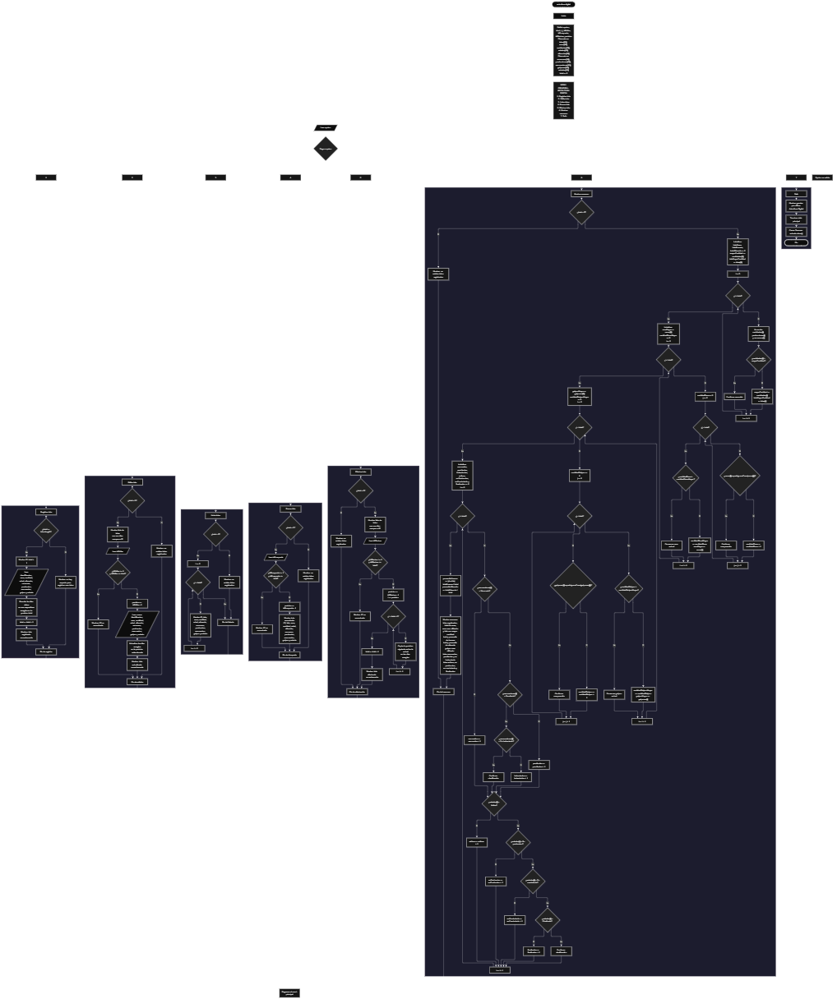

Este proyecto, llamado <b>avicultura digital</b>, fue desarrollado en <b>java</b> como un ejercicio práctico para fortalecer la lógica de programación mediante la creación de un sistema de gestión de lotes avícolas desde la consola. El programa cuenta con un menú principal de siete opciones que permite <b>registrar, editar, listar, buscar, eliminar y consultar un resumen</b> de los lotes registrados. Cada lote almacena información como la identificación, la raza, la cantidad de aves, la edad, el tipo de alimento, el consumo de alimento, la producción de huevos, el estado de vacunación, el galpón y el estado del lote, utilizando arreglos paralelos con una capacidad máxima de <b>10 lotes durante la ejecución</b>. Durante su desarrollo se aplicaron conceptos fundamentales de programación, como variables, arreglos, estructuras condicionales, ciclos repetitivos y estructuras de selección, además de operaciones para administrar registros y realizar cálculos estadísticos. Este proyecto permite poner en práctica los conocimientos adquiridos en Java y sirve como base para desarrollar sistemas de gestión avícola más avanzados utilizando otros lenguajes y tecnologías.

<h2 align="center">⚙️ Funcionamiento del menú principal</h2>

### ➕ Registrar lote

La opción <b>1) registrar lote</b> permite almacenar un nuevo lote de aves. Antes de realizar el registro, el sistema comprueba que la cantidad de lotes almacenados sea menor que la capacidad de los arreglos, utilizando la condición <b>total &gt;= lotes.length</b> para determinar si ya no existe espacio disponible. Si todavía hay posiciones libres, muestra el ID correspondiente mediante <b>total + 1</b> y solicita la <b>identificación del lote, raza, cantidad de aves, edad en semanas, tipo de alimento, consumo de alimento en kg, producción de huevos, estado de vacunación, galpón y estado del lote</b>. Los datos se almacenan en la posición correspondiente de sus respectivos arreglos. Finalmente, incrementa la variable <b>total</b> en uno y muestra el mensaje <b>"lote registrado correctamente."</b>. Si se alcanza la capacidad máxima de 10 registros, presenta el mensaje <b>"no hay espacio para registrar mas lotes."</b>, impidiendo agregar otro lote.

### ✏️ Editar lote

La opción <b>2) editar lote</b> permite modificar la información de un lote registrado. Primero, el programa comprueba si existen lotes almacenados mediante la variable <b>total</b>. Si no hay registros, muestra el mensaje <b>"no existen lotes registrados."</b>. En caso contrario, presenta una lista con el ID, la identificación del lote, la raza, la cantidad de aves, la edad, el alimento, el consumo, la producción de huevos, la vacunación, el galpón y el estado. Después, solicita el ID del lote que se desea editar y comprueba que esté dentro del rango permitido mediante la condición <b>idEditar &gt;= 1 &amp;&amp; idEditar &lt;= total</b>. Si la selección es válida, obtiene la posición correspondiente mediante <b>idEditar - 1</b> y solicita los nuevos valores de los diez campos, actualizando directamente los arreglos correspondientes. Finalmente, presenta el mensaje <b>"lote actualizado correctamente."</b>. Si el ID seleccionado no corresponde a un lote registrado, muestra el mensaje <b>"ID no encontrada."</b>.

### 📋 Listar lotes

La opción <b>3) listar lotes</b> permite visualizar todos los lotes registrados actualmente en el sistema. Antes de mostrar la información, el programa comprueba si la variable <b>total</b> es igual a cero. Si no existen registros, presenta el mensaje <b>"no existen lotes registrados."</b>. Si hay lotes disponibles, utiliza un ciclo <b>for</b> para recorrer los arreglos desde la primera posición hasta el número total de registros almacenados. Durante el recorrido, muestra el ID, la identificación del lote, la raza, la cantidad de aves, la edad en semanas, el tipo de alimento, el consumo en kg, la producción de huevos, el estado de vacunación, el galpón y el estado del lote. Esta función facilita consultar la información de todos los lotes sin necesidad de buscarlos individualmente.

### 🔎 Buscar lote

La opción <b>4) buscar lote</b> permite localizar un lote mediante su ID. Primero, el programa comprueba si existen lotes registrados. Si el sistema está vacío, muestra el mensaje <b>"no existen lotes registrados."</b>. En caso contrario, solicita el ID del lote que se desea buscar y verifica que esté dentro del rango permitido mediante la condición <b>idBusqueda &gt;= 1 &amp;&amp; idBusqueda &lt;= total</b>. Si el ID es válido, obtiene la posición correspondiente mediante <b>idBusqueda - 1</b> y muestra toda la información del lote encontrado: identificación, raza, cantidad de aves, edad, alimento, consumo, producción, vacunación, galpón y estado. Si el ID introducido no corresponde a un registro existente, presenta el mensaje <b>"ID no encontrada."</b>. La búsqueda se realiza directamente mediante el índice calculado, sin utilizar un ciclo para recorrer los registros.

### 🗑️ Eliminar lote

La opción <b>5) eliminar lote</b> permite eliminar un lote registrado mediante su ID. Antes de comenzar, el programa comprueba que existan lotes almacenados. Si no hay registros, muestra el mensaje <b>"no existen lotes registrados."</b>. Si existen lotes disponibles, presenta una lista con toda su información para facilitar la selección. Después, solicita el ID del lote que se desea eliminar y comprueba que esté dentro del rango válido mediante la condición <b>idEliminar &gt;= 1 &amp;&amp; idEliminar &lt;= total</b>. Si el lote existe, calcula su posición mediante <b>idEliminar - 1</b> y utiliza un ciclo <b>for</b> controlado por la variable <b>i</b> para desplazar una posición hacia atrás los datos de los lotes posteriores en los diez arreglos: <b>lotes, razas, cantidades, edades, alimentos, consumos, producciones, vacunaciones, galpones y estados</b>. Posteriormente, disminuye la variable <b>total</b> en uno y muestra el mensaje <b>"lote eliminado correctamente."</b>. Si el ID seleccionado no corresponde a un lote registrado, presenta el mensaje <b>"ID no encontrada."</b>. El programa no limpia explícitamente la última posición después del desplazamiento, sino que controla los registros activos mediante la variable <b>total</b>.

### 📊 Mostrar resumen

La opción <b>6) mostrar resumen</b> permite consultar estadísticas generales sobre los lotes registrados. Primero, el programa comprueba si existen registros almacenados. Si no hay lotes, muestra el mensaje <b>"no existen lotes registrados."</b>. En caso contrario, inicializa variables para acumular el total de aves, huevos y alimento consumido, además de identificar el lote con mayor cantidad de aves. Mediante un ciclo <b>for</b>, recorre los registros y suma las cantidades de aves, las producciones de huevos y los consumos de alimento. Durante el mismo recorrido, compara las cantidades de aves para determinar el lote que tiene el valor más alto.

Posteriormente, utiliza ciclos <b>for</b> anidados para analizar las frecuencias de las razas y los galpones. En cada análisis, compara los valores almacenados mediante <b>equalsIgnoreCase()</b> y cuenta cuántas veces aparece cada uno. De esta manera, identifica la raza más utilizada y el galpón más utilizado. Si existen valores con la misma frecuencia máxima, conserva el primero que alcanza esa cantidad porque la actualización se realiza únicamente cuando encuentra un resultado mayor.

Después, el programa realiza una clasificación de los estados de vacunación mediante condiciones <b>if-else if</b>, contabilizando los lotes <b>vacunados, pendientes y en tratamiento</b>. También clasifica los estados de los lotes y cuenta cuántos se encuentran <b>activos, en producción, en crecimiento y finalizados</b>. Finalmente, calcula el promedio de huevos por lote mediante <b>(double) totalHuevos / total</b> y el promedio de alimento por lote mediante <b>totalAlimento / total</b>. El resumen presenta el número de lotes registrados, el total de aves, la raza más utilizada, el lote con mayor cantidad de aves, la mayor cantidad de aves, la producción total de huevos, el promedio de huevos, el consumo total y promedio de alimento, el galpón más utilizado y las cantidades correspondientes a cada clasificación de vacunación y estado.

### 🚪 Salir del menú principal

La opción <b>7) salir</b> está destinada a finalizar la ejecución del programa y muestra el mensaje <b>"gracias por utilizar avicultura digital."</b>. El menú principal se encuentra dentro de una estructura repetitiva <b>do-while</b>, que mantiene el programa en funcionamiento mientras la opción seleccionada sea diferente de <b>7</b>. Cuando el usuario selecciona esta opción, la condición del ciclo se cumple y el programa finaliza su repetición. Finalmente, ejecuta <b>entrada.close()</b> para cerrar el objeto <b>Scanner</b>.

<h2 align="center">🧠 Temas aplicados en el proyecto</h2>

### 📦 Variables

En este proyecto se utilizan variables para controlar la opción seleccionada en el menú, la cantidad de lotes registrados, las posiciones de los arreglos, los ID de los registros y los cálculos estadísticos del resumen. También se emplean variables auxiliares para identificar la raza y el galpón con mayor frecuencia, determinar el lote con mayor cantidad de aves, acumular las cantidades de aves, huevos y alimento, y contabilizar los diferentes estados de vacunación y de los lotes. Cada variable cumple una función específica dentro de las operaciones de gestión y análisis de la información.

🔢 **Opcion:** Almacena la opción seleccionada por el usuario en el menú principal.

📊 **Total:** Almacena la cantidad actual de lotes registrados.

🔄 **I:** Funciona como contador en los ciclos `for` y permite recorrer las posiciones de los arreglos.

🔁 **J:** Controla el recorrido interno de los ciclos anidados utilizados para calcular las frecuencias de las razas y los galpones.

🆔 **IdEditar, IdBusqueda e IdEliminar:** Almacenan los ID introducidos por el usuario para editar, buscar o eliminar un lote.

📍 **Posicion:** Almacena el índice calculado a partir del ID seleccionado para acceder al registro correspondiente.

🐔 **TotalAves:** Acumula la cantidad total de aves registradas en todos los lotes.

🥚 **TotalHuevos:** Acumula la producción total de huevos de los lotes registrados.

🌾 **TotalAlimento:** Acumula el consumo total de alimento expresado en kilogramos.

📈 **MayorCantidad y LoteMayorCantidad:** Almacenan la mayor cantidad de aves encontrada y la identificación del lote correspondiente.

🧬 **RazaMayor y CantidadRazaMayor:** Almacenan la raza con mayor frecuencia y la cantidad de veces que aparece.

🏠 **GalponMayor y CantidadGalponMayor:** Almacenan el galpón con mayor frecuencia y la cantidad de veces que aparece.

💉 **Vacunados, Pendientes y Tratamientos:** Contabilizan los lotes según su estado de vacunación.

📋 **Activos, EnProduccion, EnCrecimiento y Finalizados:** Contabilizan los lotes según su estado actual.

📊 **PromedioHuevos y PromedioAlimento:** Almacenan los promedios de producción de huevos y consumo de alimento por lote.

### 🗃️ Arreglos

En este proyecto se utilizan diez arreglos paralelos relacionados con la información de cada lote avícola. Cada arreglo tiene una capacidad de <b>10 posiciones</b> y utiliza el mismo índice para representar los datos correspondientes a un mismo lote. Por ejemplo, la información de un lote almacenado en la posición <b>0</b> se encuentra distribuida entre <b>lotes[0], razas[0], cantidades[0], edades[0], alimentos[0], consumos[0], producciones[0], vacunaciones[0], galpones[0] y estados[0]</b>. Esta organización permite registrar, consultar, modificar, mostrar y eliminar los lotes manteniendo relacionados todos sus datos.

🐔 **Lotes[10]:** Almacena la identificación de los lotes registrados.

🧬 **Razas[10]:** Almacena las razas de las aves de cada lote.

🔢 **Cantidades[10]:** Almacena la cantidad de aves de cada lote.

📅 **Edades[10]:** Almacena la edad de las aves expresada en semanas.

🌾 **Alimentos[10]:** Almacena el tipo de alimento asignado a cada lote.

⚖️ **Consumos[10]:** Almacena el consumo de alimento en kilogramos.

🥚 **Producciones[10]:** Almacena la cantidad de huevos producidos por cada lote.

💉 **Vacunaciones[10]:** Almacena el estado de vacunación de cada lote.

🏠 **Galpones[10]:** Almacena el galpón asignado a cada lote.

📋 **Estados[10]:** Almacena el estado actual de cada lote.

### 🔀 Estructuras condicionales

En este proyecto se utilizan las estructuras <b>if, else y else if</b> para comprobar si existe espacio disponible antes de registrar un lote, verificar si hay registros antes de realizar determinadas operaciones, validar el ID seleccionado para editar, buscar o eliminar información, identificar el lote con mayor cantidad de aves y clasificar los estados de vacunación y de los lotes. También se utiliza <b>equalsIgnoreCase()</b> para comparar las razas, los galpones y los estados sin distinguir entre mayúsculas y minúsculas. Estas condiciones permiten que el programa responda de manera diferente según la información almacenada y el resultado de cada operación.

### 🔄 Estructuras repetitivas

En este proyecto se utilizan los ciclos <b>for</b> y <b>do-while</b>. Los ciclos <b>for</b> permiten recorrer los arreglos para mostrar los lotes, acceder a sus datos, acumular cantidades y realizar los cálculos estadísticos del resumen. También se utilizan ciclos <b>for</b> anidados para comparar las razas y los galpones, contando cuántas veces aparece cada valor. Durante la eliminación, un ciclo <b>for</b> desplaza los datos de los registros posteriores una posición hacia atrás. Por otro lado, el ciclo <b>do-while</b> mantiene activo el menú principal y permite ejecutar las diferentes operaciones hasta que el usuario selecciona la opción <b>7</b>.

### 🎯 Estructura switch

El programa utiliza la estructura <b>switch</b> para evaluar el valor almacenado en la variable <b>opcion</b> y ejecutar el bloque de instrucciones correspondiente. Cada caso representa una operación específica del sistema: <b>registrar, editar, listar, buscar, eliminar, mostrar resumen o salir</b>. También se utiliza el bloque <b>default</b> para mostrar el mensaje <b>"opcion no valida."</b> cuando el usuario introduce un número que no corresponde a ninguna de las opciones definidas en el menú.

### 🔢 Dimensionamiento de arreglos

El programa utiliza la creación de arreglos mediante la instrucción <b>new</b> para establecer la capacidad de los espacios donde se almacena la información de los lotes. Se definieron <b>10 posiciones</b> para cada uno de los diez arreglos, lo que permite administrar hasta 10 lotes durante la ejecución. La cantidad de posiciones ocupadas se controla mediante la variable <b>total</b>, por lo que las operaciones recorren únicamente los registros comprendidos entre la primera posición y el total actual de lotes.

### 🔄 Reorganización de registros

Cuando se selecciona un lote para eliminarlo, el programa utiliza un ciclo <b>for</b> que comienza en la posición seleccionada y llega hasta <b>total - 1</b>. En cada repetición, los datos de la posición siguiente se copian sobre la posición actual en los diez arreglos: <b>lotes, razas, cantidades, edades, alimentos, consumos, producciones, vacunaciones, galpones y estados</b>. Después, la variable <b>total</b> disminuye en uno. De esta manera, los registros posteriores ocupan las posiciones anteriores sin dejar espacios vacíos entre los lotes activos. La última posición no se limpia explícitamente, pero deja de formar parte de los registros utilizados porque el programa controla su cantidad mediante <b>total</b>.

### 📊 Análisis estadístico

El programa utiliza operaciones aritméticas y recorridos de arreglos para obtener información estadística sobre la actividad avícola. Mediante acumuladores calcula el total de aves, huevos producidos y alimento consumido. También compara las cantidades de aves para identificar el lote con mayor población y emplea ciclos anidados para determinar la raza y el galpón que aparecen con mayor frecuencia. Finalmente, utiliza divisiones para calcular el promedio de huevos y el promedio de alimento por lote. Estos procedimientos permiten obtener un resumen general de la información registrada sin utilizar estructuras adicionales de almacenamiento.

<h2 align="center">¿Cómo se implementaron las operaciones crud en el proyecto?</h2>

Las operaciones <b>crud</b> se implementaron mediante las opciones del menú principal, permitiendo administrar los lotes avícolas registrados. La operación <b>crear</b> corresponde a <b>registrar lote</b>, donde se introducen los datos de un nuevo lote; <b>leer</b> se realiza mediante las opciones <b>listar lotes y buscar lote</b>, que permiten consultar la información almacenada; <b>actualizar</b> corresponde a <b>editar lote</b>, donde se modifican los datos de un registro existente; y <b>eliminar</b> se realiza mediante la opción <b>eliminar lote</b>, que retira un registro y reorganiza los datos de los arreglos. La opción <b>mostrar resumen</b> complementa estas operaciones mediante cálculos estadísticos de los registros existentes. Todas estas funcionalidades utilizan variables, arreglos, condicionales y ciclos para gestionar la información temporalmente durante la ejecución del programa.

<h2 align="center">Diagrama de flujo del proyecto</h2>

<h2 align="center">🛡️ Validaciones del programa</h2>

### 📭 No existen lotes registrados

Esta validación se utiliza en las opciones de <b>editar, listar, buscar, eliminar y mostrar resumen</b>. El programa comprueba si la variable <b>total</b> es igual a <b>0</b> y, si no existen lotes registrados, muestra el mensaje <b>"no existen lotes registrados."</b>. Esta comprobación evita continuar con las operaciones que necesitan información almacenada cuando el sistema está vacío.

### ⚠️ Capacidad máxima de lotes

Esta validación se utiliza durante el registro de nuevos lotes para controlar la capacidad máxima de los arreglos. El programa comprueba si <b>total &gt;= lotes.length</b> antes de permitir agregar otro registro. Si se alcanza la capacidad de <b>10 lotes</b>, muestra el mensaje <b>"no hay espacio para registrar mas lotes."</b> e impide continuar con el registro. Si existe espacio disponible, solicita los datos del lote y aumenta la variable <b>total</b> en uno después de almacenarlos.

### 🔢 Selección de lotes

El programa utiliza las variables <b>idEditar, idBusqueda e idEliminar</b> para identificar el lote que se desea editar, buscar o eliminar. Antes de realizar estas operaciones, comprueba que el ID introducido sea mayor o igual a <b>1</b> y menor o igual al valor de <b>total</b>. Si la selección está dentro del rango permitido, calcula la posición correspondiente restando uno al ID. En caso contrario, muestra el mensaje <b>"ID no encontrada."</b>. Esta validación evita acceder a posiciones que no corresponden a lotes registrados.

### 📊 Existencia de registros para el resumen

Antes de realizar los cálculos estadísticos, el programa comprueba que exista al menos un lote registrado. Si la variable <b>total</b> es igual a cero, muestra el mensaje <b>"no existen lotes registrados."</b> y no ejecuta las operaciones de acumulación, comparación, frecuencia y promedio. Esta comprobación evita realizar los cálculos del resumen cuando no existen datos disponibles.

### ⚠️ Opción inválida

La estructura <b>switch</b> incluye el bloque <b>default</b>, que muestra el mensaje <b>"opcion no valida."</b> cuando el usuario introduce un número que no corresponde a ninguna de las opciones definidas en el menú principal. De esta manera, el programa informa que la selección realizada no está disponible y permite continuar con la ejecución del menú.

<h2 align="center">🎯 Objetivo del proyecto</h2>

El objetivo principal de este proyecto es fortalecer la <b>lógica de programación</b> mediante el desarrollo de un sistema de gestión avícola en <b>java</b>. A través de su construcción se busca aplicar los conocimientos adquiridos sobre variables, arreglos, estructuras condicionales, ciclos repetitivos y estructuras de selección, integrándolos para resolver un problema de manera organizada. Además, el proyecto permite comprender cómo registrar, consultar, modificar y eliminar información de diferentes lotes, así como realizar cálculos estadísticos relacionados con la cantidad de aves, la producción de huevos, el consumo de alimento, las razas, los galpones y los estados de vacunación. De esta manera, se establece una base para desarrollar sistemas de gestión más completos utilizando otros lenguajes y tecnologías.

